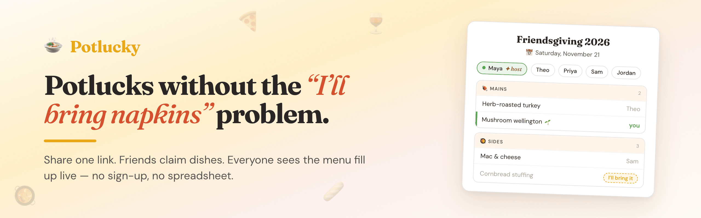
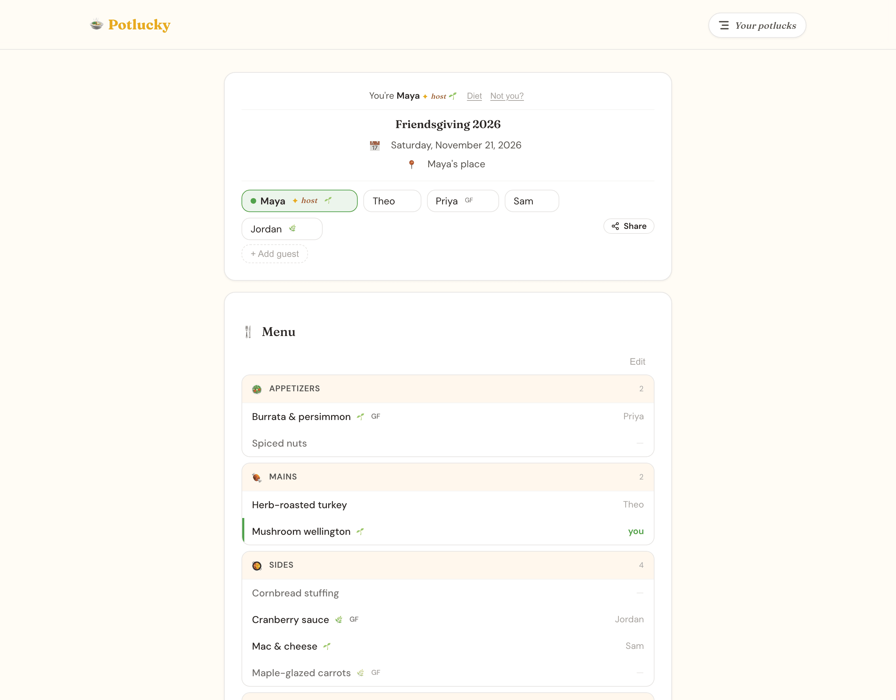
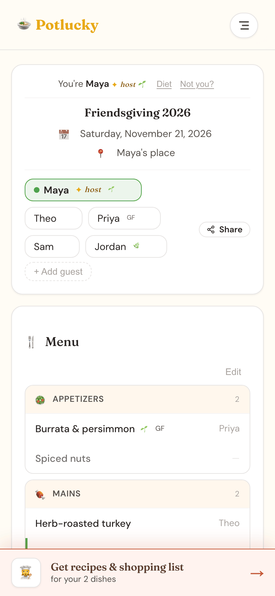
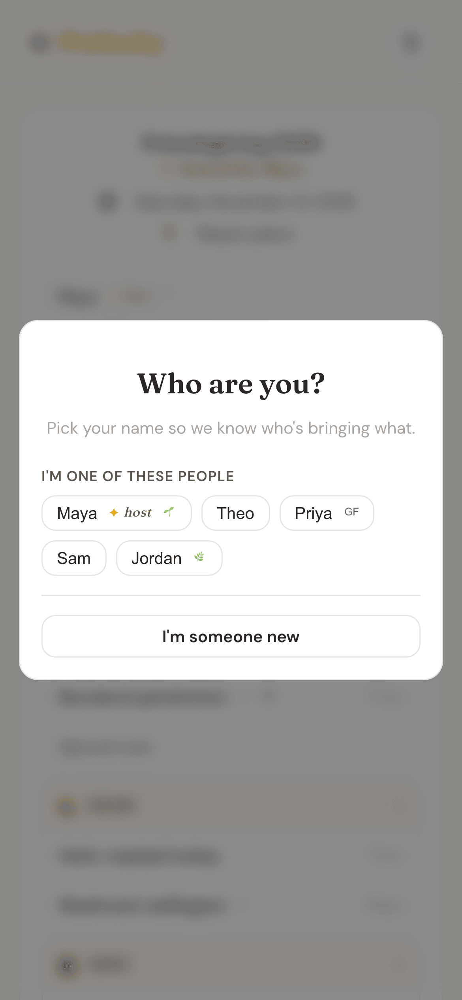
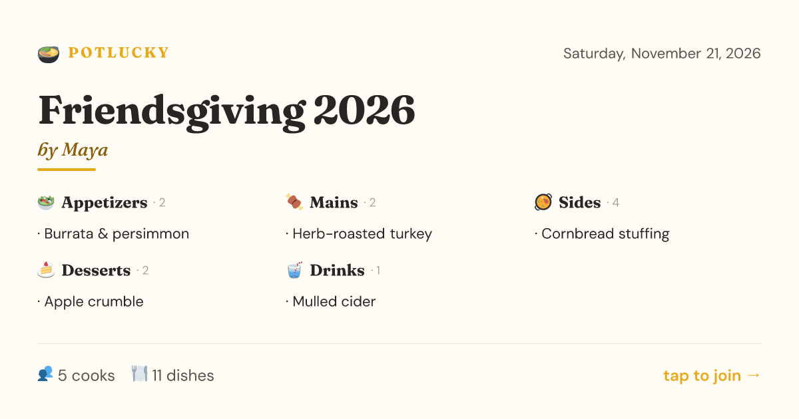

<p align="center">
  
</p>

<p align="center">
  <b>Plan a potluck in one link. Friends claim dishes, everyone sees the menu fill up live.</b><br />
  <a href="https://potlucky-seven.vercel.app">potlucky-seven.vercel.app</a>
</p>

<p align="center">
  <a href="https://github.com/awlevin/potlucky/actions/workflows/ci.yml"></a>
  <a href="LICENSE"></a>
</p>

---

Every potluck has the same failure mode: six people bring chips, one person
brings napkins, and nobody brings a main. Potlucky fixes that with a shared
menu. Start a room, send the link to the group chat, and people claim what
they're bringing. No accounts, no app to install, no spreadsheet.

<table>
  <tr>
    <td width="62%"></td>
    <td width="38%"></td>
  </tr>
  <tr>
    <td align="center"><sub>The room: guests up top, menu by course, your dishes in green</sub></td>
    <td align="center"><sub>Built for the phone you're holding in the grocery store</sub></td>
  </tr>
</table>

## Features

- **One-click rooms.** Hit _Start a Potluck_, get a link like
  `/potlucks/pumpkin-pleasant-9x2Qk`, share it. The link is the invite.
- **Live dish claiming.** Everyone sees claims the moment they happen, so two
  people never bring the same mac & cheese.
- **Themed starter menus.** Thanksgiving, Friendsgiving, Hanukkah, taco night,
  Super Bowl and 50+ more, each with a curated menu you can tweak. Every
  theme also has its own landing page under [`/ideas`](https://potlucky-seven.vercel.app/ideas).
- **Dietary tags.** Mark dishes vegetarian, vegan, gluten-free, nut-free or
  dairy-free; guests can note their own needs so the group can plan around them.
- **Recipes + shopping list.** Pick a dish you're bringing and Claude suggests
  three takes on it, writes the recipe scaled to your headcount, and builds an
  aisle-sorted shopping list.
- **Pretty link previews.** Share a room and the preview card shows the
  actual menu.

<table>
  <tr>
    <td width="38%"></td>
    <td width="62%"></td>
  </tr>
  <tr>
    <td align="center"><sub>Opening a shared link: pick your name, you're in</sub></td>
    <td align="center"><sub>The link preview your group chat sees</sub></td>
  </tr>
</table>

## How it works

1. **Start a room.** The browser writes a new room document with a random,
   unguessable id (`<word>-<word>-<nanoid>`).
2. **Share the link.** Opening it shows the identity gate: pick your name from
   the guest list or add yourself. Your identity for that room lives in
   `localStorage`, so there's no sign-up.
3. **Claim dishes.** The room page subscribes to the room in realtime; every
   add, claim and edit shows up for everyone at once.
4. **Cook.** The recipe wizard calls `/api/recipes`, a small route that
   streams recipes from Claude (Haiku) and is validated and rate-limited.

Rooms are unlisted: knowing the link is what lets you in, and room pages are
`noindex`. The data layer is mid-migration from Firestore to Supabase (with
proper auth and row-level security). See [`supabase/README.md`](supabase/README.md)
for the schema and its security model.

## Tech stack

| | |
| --- | --- |
| Framework | [Next.js 14](https://nextjs.org/) (App Router) + TypeScript |
| UI | [Chakra UI v3](https://chakra-ui.com/), [Framer Motion](https://www.framer.com/motion/), hand-written CSS design tokens in `app/globals.css` |
| Type | [Fraunces](https://fonts.google.com/specimen/Fraunces) + [DM Sans](https://fonts.google.com/specimen/DM+Sans) |
| Realtime data | [Cloud Firestore](https://firebase.google.com/docs/firestore) today, [Supabase](https://supabase.com/) (Postgres + RLS + Realtime) next |
| AI | [Anthropic API](https://docs.anthropic.com/) (Claude Haiku) |
| Link previews | `next/og` image routes |
| Hosting | [Vercel](https://vercel.com/) |

## Run it locally

You need Node 20 (see `.node-version`), Yarn 1, Java 11+ (for the Firestore
emulator), and Docker + the [Supabase CLI](https://supabase.com/docs/guides/cli)
(`brew install supabase/tap/supabase`). No cloud accounts required.

```bash
git clone https://github.com/awlevin/potlucky.git
cd potlucky
yarn install

# 1. Local Supabase (auth + the next-gen schema). Prints URL and keys.
supabase start

# 2. Env file. Paste ANON_KEY and SERVICE_ROLE_KEY from `supabase status -o env`.
cp .env.example .env.local

# 3. Local Firestore, in its own terminal. Data is in-memory.
yarn emulators

# 4. The app
yarn dev
```

Open [localhost:3000](http://localhost:3000) and start a potluck.

### Environment variables

All of them are listed in [`.env.example`](.env.example).

| Variable | Needed for | Notes |
| --- | --- | --- |
| `NEXT_PUBLIC_SITE_URL` | canonical URLs, OG tags, auth emails | `http://localhost:3000` locally |
| `NEXT_PUBLIC_FIREBASE_PROJECT_ID` | rooms | `demo-potlucky` with the emulator |
| `NEXT_PUBLIC_FIRESTORE_EMULATOR_HOST` | local dev | `127.0.0.1:8080`; remove to use a real Firebase project |
| `NEXT_PUBLIC_FIREBASE_*` | a real Firebase project | Web app config from the Firebase console |
| `NEXT_PUBLIC_SUPABASE_URL`, `NEXT_PUBLIC_SUPABASE_ANON_KEY` | auth session middleware | from `supabase status -o env` locally |
| `SUPABASE_SERVICE_ROLE_KEY` | server-only admin reads | bypasses RLS: never expose it to the browser |
| `ANTHROPIC_API_KEY` | recipe wizard | optional; everything else works without it |
| `NEXT_PUBLIC_FEATURE_DISH_GALLERY` | Dish Gallery (WIP) | set to `1` to enable |

`NEXT_PUBLIC_*` values end up in the browser bundle. Firebase web config and
the Supabase anon key are designed to be public; the security comes from the
Firestore rules and Postgres RLS policies in this repo.

## Scripts

| Command | What it does |
| --- | --- |
| `yarn dev` | Dev server on :3000 |
| `yarn build` / `yarn start` | Production build / serve it |
| `yarn lint` / `yarn typecheck` | ESLint / `tsc --noEmit` |
| `yarn emulators` | Firestore emulator with `firestore.rules` loaded |
| `yarn test:firestore-rules` | Tests `firestore.rules` against the emulator |
| `yarn test:db` | Supabase RLS tests (`supabase/tests/`, needs `supabase start`) |
| `yarn screenshots` | Seeds a demo room and regenerates `docs/screenshots/` |
| `yarn brand-images` | Regenerates `docs/banner.png` and `docs/social-preview.png` |

CI runs lint, typecheck, build and both security test suites on every PR.

## Project layout

```
app/                 Next.js routes (home, /potlucks/[roomId], /ideas, /api/recipes, OG images)
src/components/      UI, incl. the room, identity gate and recipe wizard
src/data/            Theme presets and dish suggestions
src/lib/firebase/    Firestore client (current data layer)
src/lib/data/        Repository interface + Supabase implementation (next data layer)
supabase/            Migrations, RLS tests, local config
firestore.rules      Firestore security rules (+ scripts/test-firestore-rules.mjs)
docs/                README images
```

## Security

Found a vulnerability? Please report it privately through GitHub
(**Security → Report a vulnerability**) instead of opening a public issue.

## License

[MIT](LICENSE) © Aaron Levin
